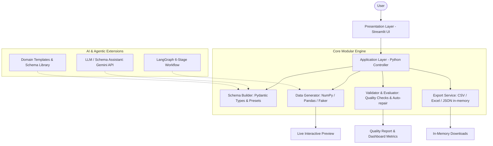

# 🗄️ Synthetic Dataset Generator

A modern, production-grade, modular web application for designing, generating, validating, and exporting realistic artificial datasets for Machine Learning, Deep Learning, and scientific research.

Built with **Python**, **Streamlit**, **Pandas**, **NumPy**, **Faker**, **Pydantic**, **Plotly**, and **OpenPyXL**.

---

## 🌟 Key Features

- **Domain-Specific Presets**:
  - 🏥 **Healthcare**: Clinical cardiovascular and metabolic risk markers (`Patient_ID`, `Age`, `BMI`, `Blood_Pressure`, `Cholesterol`, `Glucose`, `Smoking`, `Disease`).
  - 💳 **Banking and Finance**: Credit risk, annual income, credit score, loan amount, and debt-to-income defaults.
  - 🛒 **E-commerce**: Customer purchase frequency, average order value, satisfaction score, and churn prediction.
  - 🎓 **Education**: Academic attendance, weekly study hours, GPA, and exam performance forecasting.
  - 🌾 **Agriculture**: Soil moisture, pH, N-P-K mineral levels, weather indices, and crop yield forecasting.
  - ⚙️ **General ML**: Configurable high-dimensional distributions with customizable covariance.

- **Supervised & Unsupervised Machine Learning Tasks**:
  - **Classification**: Configurable class balance with latent logistic risk modeling.
  - **Regression**: Continuous non-linear feature interactions with controlled Gaussian noise.
  - **Clustering**: Multi-modal Gaussian centroid structures for unsupervised clustering.
  - **General-purpose**: Schema-driven synthesis without mandatory target columns.

- **Realistic Data Modeling & Constraints**:
  - Enforces biological, physical, and domain boundaries.
  - Configurable missing value injection with reproducible random masks (ID columns protected).
  - Reproducibility via random seed control.
  - Controlled noise injection and optional duplicate row generation.

- **Quality Audit & Auto-Repair Engine**:
  - Structural checks: Shape verification, schema conformance, zero infinite values.
  - Bounds & domain validity: Automatic clipping of boundary violations.
  - Comprehensive quality report with an overall 0–100 score.

- **Interactive Analytics Dashboard**:
  - Target/Class Distribution Donut Chart with sample count callout.
  - Correlation Heatmap across numeric dimensions (-1 to +1).
  - Interactive Feature Distribution Histograms with column selector.
  - Summary Statistics Table (Type, Non-Null, Missing %, Mean, Std, Min, Max).

- **Multi-Format In-Memory Exports**:
  - 📄 **CSV** (Comma-separated values)
  - 📊 **Excel** (`.xlsx` multi-cell formatting via OpenPyXL)
  - 🔣 **JSON** (Record-oriented array for API workflows)
  - Generated on-the-fly in memory without cluttering server storage.

- **Future Generative AI & Agentic AI Architecture**:
  - Clean modular hooks ready for Google Gemini API integration and LangGraph 6-stage agentic workflow (`ai/llm_service.py`, `ai/schema_agent.py`, `ai/workflow.py`).

---

## 🏗️ System Architecture



---

## 📁 Project Directory Structure

```text
synthetic_dataset_generator/
├── app.py                      # Main Streamlit web application
├── requirements.txt            # Dependency specifications
├── README.md                   # Complete documentation and setup guide
│
├── components/                 # Presentation & UI modules
│   ├── __init__.py
│   ├── configuration.py        # Left configuration card & form controls
│   ├── preview.py              # Interactive dataset preview & row pagination
│   └── quality_dashboard.py    # Analytics charts, statistics & export buttons
│
├── core/                       # Core generation and validation engine
│   ├── __init__.py
│   ├── schema_builder.py       # Pydantic schemas, column configs & presets
│   ├── data_generator.py       # NumPy/Faker generation, distributions & constraints
│   ├── validator.py            # Quality audit, bounds checks & auto-repair
│   └── exporter.py             # In-memory CSV, Excel (.xlsx), and JSON exporters
│
├── ai/                         # Future Generative AI & Agentic AI hooks
│   ├── __init__.py
│   ├── llm_service.py          # Gemini API integration & heuristic parser fallback
│   ├── schema_agent.py         # Natural language prompt to schema translation
│   └── workflow.py             # 6-stage LangGraph-ready pipeline state graph
│
├── tests/                      # Automated Pytest suite
│   ├── __init__.py
│   ├── test_generator.py       # Generator, reproducibility & distribution tests
│   └── test_validator.py       # Validator, schema, repair & export tests
│
└── generated_datasets/         # Optional local output directory
```

---

## 🚀 Quickstart & Setup Guide (Windows)

### Prerequisites
- **Python 3.10+** (Tested on Python 3.10, 3.11, 3.12, 3.13, 3.14)
- **pip** package installer
- **Git**

### Step 1: Open PowerShell or Command Prompt
Open your terminal in the project directory:
```powershell
cd c:\Users\wanig\OneDrive\Desktop\sih_web\synthetic_dataset_generator
```

### Step 2: (Optional but Recommended) Create a Virtual Environment
```powershell
python -m venv venv
.\venv\Scripts\Activate.ps1
```
*(If PowerShell restricts script execution, run: `Set-ExecutionPolicy -Scope Process -ExecutionPolicy Bypass`)*

### Step 3: Install Required Dependencies
```powershell
pip install -r requirements.txt
```

### Step 4: Launch the Web Application
```powershell
streamlit run app.py
```
Or from the parent directory:
```powershell
streamlit run synthetic_dataset_generator/app.py
```

The application will launch automatically in your default browser at:
👉 **`http://localhost:8501`**

---

## 🧪 Running Automated Tests

Run the test suite using `pytest`:

```powershell
python -m pytest synthetic_dataset_generator/tests -v
```

All 11 unit and integration tests will execute, validating:
- Numeric boundary clipping and categorical domain conformance.
- Classification binary target generation and class balance ratios.
- Regression continuous target generation.
- Unsupervised clustering features.
- Bitwise reproducibility across matching random seeds.
- Missing value percentage accuracy.
- Schema validation against duplicate columns.
- Quality report calculation and automatic boundary repairs.
- In-memory CSV, Excel (`.xlsx`), and JSON exports.

---

## 🛠️ Troubleshooting Common Issues

1. **Port `8501` already in use**:
   Launch Streamlit on a different port:
   ```powershell
   streamlit run app.py --server.port 8502
   ```

2. **PowerShell execution policy error when activating venv**:
   Run:
   ```powershell
   Set-ExecutionPolicy -Scope Process -ExecutionPolicy Bypass
   .\venv\Scripts\Activate.ps1
   ```

3. **Missing Excel writer support**:
   Ensure `openpyxl` is installed:
   ```powershell
   pip install openpyxl
   ```

---

## ☁️ Deployment to Streamlit Community Cloud

1. Commit your codebase to a GitHub repository:
   ```bash
   git init
   git add .
   git commit -m "Initial commit of Synthetic Dataset Generator"
   git remote add origin https://github.com/your-username/synthetic-dataset-generator.git
   git push -u origin main
   ```
2. Navigate to [share.streamlit.io](https://share.streamlit.io).
3. Connect your GitHub account and select your repository.
4. Set the main file path to: `synthetic_dataset_generator/app.py` (or `app.py`).
5. Click **Deploy**! Your application will be live globally.

---

## 🎓 Academic Syllabus Note
Designed for practical Machine Learning & Deep Learning experimentation and Generative AI / Agentic AI coursework.
